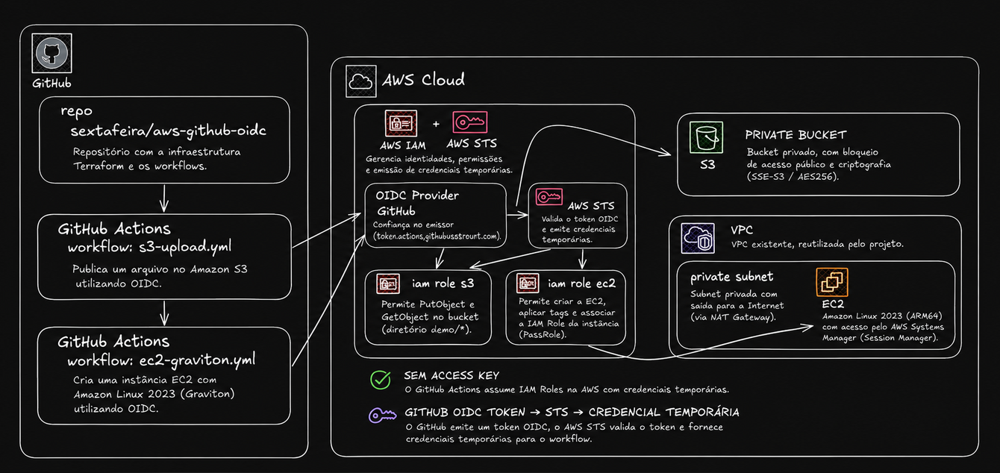

# GitHub Actions + AWS OIDC com Terraform

Infraestrutura para demonstrar GitHub Actions autenticando na AWS com OIDC, sem access keys no GitHub. Dois testes: upload de arquivo no S3 e criação de uma EC2 Amazon Linux 2023 Graviton para acesso via Session Manager.

## Arquitetura



Os workflows obtêm credenciais temporárias pelo AWS STS usando OIDC e assumem roles IAM separadas para S3 e EC2. A instância é criada na subnet privada da VPC existente e recebe uma role para acesso pelo Session Manager.

## Estrutura

- `providers.tf`: configuração do provider e versões.
- `data.tf`: dados da conta/partição AWS.
- `vpc_data.tf`: VPC e subnet privada consultadas pelos parâmetros `/vpc_id` e `/private_subnet_1a_id`, seguindo `aws-session-manager`.
- `security_group.tf`: security group da EC2, sem entrada e com saída HTTPS.
- `oidc.tf`: provider OIDC, trust policy e roles do GitHub.
- `ec2_iam.tf`: role da instância, policy `AmazonSSMManagedInstanceCore` e instance profile, seguindo o padrão do `ecs_iam.tf` dos projetos ECS.
- `github_ec2_iam.tf`: permissões da Action para criar EC2 e passar a role SSM.
- `s3.tf`: bucket privado e permissões para upload/leitura no prefixo `demo/`.
- `live/sandbox/`: valores das variáveis e configuração do backend S3.

As variáveis não possuem `type` ou `default`; os valores são definidos no ambiente.

## Subir a infraestrutura

Pré-requisitos: Terraform >= 1.10 (locking S3 com `use_lockfile`), AWS CLI v2, credenciais locais com permissões para provisionar os recursos e o bucket de backend já existente. A VPC e a subnet privada devem existir na região escolhida e seus IDs devem estar no Parameter Store.

Revise `live/sandbox/terraform.tfvars` e `live/sandbox/backend.tfvars`. O backend segue o bucket usado nos repos locais, com uma key própria para este projeto.

```bash
aws sts get-caller-identity
terraform init -backend-config=live/sandbox/backend.tfvars
terraform plan -var-file=live/sandbox/terraform.tfvars -out=demo.tfplan
terraform apply demo.tfplan
terraform output -json github_variables
```

O Terraform gerencia diretamente o provider OIDC do GitHub, sem criação condicional. Se ele já existir fora deste state, importe antes de aplicar:

```bash
terraform import -var-file=live/sandbox/terraform.tfvars \
  aws_iam_openid_connect_provider.github \
  arn:aws:iam::CONTA:oidc-provider/token.actions.githubusercontent.com
```

`github_owner` contém `sextafeira` e `github_repository` contém somente `aws-github-oidc`. A trust policy é montada com `jsonencode` diretamente na role, sem `locals` ou `data "aws_iam_policy_document"`.

`github_owner_id` e `github_repository_id` correspondem aos IDs numéricos do GitHub. O subject usa o formato imutável `repo:OWNER@OWNER_ID/REPO@REPO_ID:ref:refs/heads/BRANCH`. Se apagar e recriar o repositório, atualize `github_repository_id` antes de provisionar novamente.

A trust policy permite assumir as roles somente pelo repositório e branch definidos no ambiente, com `aud = sts.amazonaws.com`. Os workflows não usam GitHub Environments; adicionar `environment:` exige ajustar o subject (`sub`) da trust policy.

## Configurar as Actions

Faça commit/push dos workflows. Em **Settings → Secrets and variables → Actions → Variables**, cadastre os valores exibidos no output `github_variables`:

| Variável | Uso |
| --- | --- |
| `AWS_REGION` | Região AWS |
| `AWS_S3_ROLE_ARN` | Role OIDC do teste S3 |
| `AWS_EC2_ROLE_ARN` | Role OIDC do teste EC2 |
| `S3_BUCKET_NAME` | Bucket de upload |
| `SUBNET_ID` | Subnet privada consultada via Parameter Store pelo Terraform |
| `SECURITY_GROUP_ID` | Security group da EC2 |
| `IAM_INSTANCE_PROFILE_NAME` | Instance profile com a role SSM |

Não é necessário cadastrar access keys. Os dois workflows executam em `push` na `main`, incluindo o push produzido pelo merge de um PR. Não executam no evento `pull_request` nem possuem disparo manual. Configure as repository variables e aplique a trust policy atualizada antes do merge. Cada push na `main` executa os dois testes e cria outra EC2.

## Teste S3

Após o merge na `main`, acompanhe **Actions → OIDC - Upload no S3**.

A Action mostra a identidade AWS, publica `examples/hello.txt` no prefixo `demo/` e consulta os metadados do objeto. Confira o arquivo no console S3. O bucket permanece privado.

## Teste EC2 + Session Manager

Após o merge na `main`, acompanhe **Actions → OIDC - EC2 Amazon Linux Graviton**.

A Action executa `aws ec2 run-instances` diretamente, usando o parâmetro público da AMI Amazon Linux 2023 ARM64, tipo `t4g.micro`, subnet privada, security group e instance profile SSM. Não há script auxiliar nem encerramento automático. O ID da instância aparece no log.

Depois de a instância inicializar e o SSM Agent registrar, abra **EC2 → Instância → Conectar → Session Manager**.

Para acessar pelo terminal local, instale o [plugin do Session Manager para a AWS CLI](https://docs.aws.amazon.com/systems-manager/latest/userguide/session-manager-working-with-install-plugin.html), configure o profile `sextafeira` e execute:

```bash
aws --region us-east-1 --profile sextafeira ssm start-session --target i-0f09bb94e7e6ed9a4
```

O ID acima é um exemplo: substitua pelo `InstanceId` exibido na execução da Action. Use seu próprio profile e região se forem diferentes. A sessão usa as permissões da sua identidade local; a role OIDC da Action apenas provisiona a instância.

Dentro da sessão na EC2, execute:

```bash
uname -m
cat /etc/os-release
```

O resultado esperado é arquitetura `aarch64` e Amazon Linux 2023. Mantivemos Graviton da proposta original; `t3.micro` exigiria a AMI x86_64.

O Amazon Linux 2023 já inclui o SSM Agent. A instância recebe `AmazonSSMManagedInstanceCore` e saída TCP 443. A rede existente precisa fornecer acesso aos serviços SSM, via NAT Gateway ou VPC endpoints com DNS e security groups adequados. Sua identidade de operador também precisa de permissão para iniciar sessões. Veja os [pré-requisitos de conectividade do SSM Agent](https://docs.aws.amazon.com/systems-manager/latest/userguide/troubleshooting-ssm-agent.html).

A role da Action permite `RunInstances` e `CreateTags` na região configurada; `iam:PassRole` fica restrito à role SSM criada neste projeto. A policy de lançamento é ampla para manter o exemplo simples e não limita o tipo de instância ou a subnet. A Action não recebe permissão para abrir sessões SSM ou encerrar instâncias.

## Sequência para o vídeo

1. Explicar GitHub → token OIDC → AWS STS → credenciais temporárias.
2. Mostrar a trust policy (`aud`, repositório e branch) e as permissões das duas roles.
3. Mostrar a rede no Parameter Store e aplicar a infra usando `live/sandbox/`.
4. Configurar as repository variables sem access keys.
5. Rodar o upload e conferir o objeto no S3.
6. Rodar a Action EC2, acessar via Session Manager e mostrar `uname -m`.
7. Mostrar a identidade assumida e comparar as permissões das roles S3 e EC2.
8. Encerrar a EC2 e destruir a infraestrutura da demo.

Para a gravação com execução ao abrir PR, altere depois o trigger para `pull_request` e a trust policy para aceitar o subject terminado em `:pull_request`. Esta versão executa somente após pushes na `main`.

## Limpeza

A EC2 criada pela Action fica fora do state Terraform e permanece ligada, gerando custos. Encerre-a manualmente antes de destruir a infra e aguarde o estado `terminated`. Exclua também os arquivos do bucket usando suas credenciais locais:

```bash
aws ec2 terminate-instances --region us-east-1 --instance-ids i-SUBSTITUA
aws ec2 wait instance-terminated --region us-east-1 --instance-ids i-SUBSTITUA
aws s3 rm s3://NOME-DO-BUCKET/demo/ --recursive --region us-east-1
terraform destroy -var-file=live/sandbox/terraform.tfvars
```

O bucket não usa `force_destroy`; precisa estar vazio. VPC, subnet e parâmetros existentes não são removidos.

## Referências

- [AWS Brasil: Como utilizar IAM Roles para conectar o GitHub Actions na AWS](https://aws.amazon.com/pt/blogs/aws-brasil/como-utilizar-iam-roles-para-conectar-o-github-actions-na-aws/): referência para o fluxo OIDC, trust policy e autenticação com credenciais temporárias.
- [GitHub: referência OIDC e subjects imutáveis](https://docs.github.com/en/actions/reference/security/oidc#immutable-subject-claims): formato do subject com os IDs do owner e do repositório usado neste projeto.
- [AWS: iniciar uma sessão do Session Manager](https://docs.aws.amazon.com/systems-manager/latest/userguide/session-manager-working-with-sessions-start.html).
- [AWS: instalar o plugin do Session Manager](https://docs.aws.amazon.com/systems-manager/latest/userguide/session-manager-working-with-install-plugin.html).

O artigo da AWS Brasil apresenta o subject com nomes de owner/repositório. Este projeto usa o formato imutável com IDs, conforme a documentação atual do GitHub.
